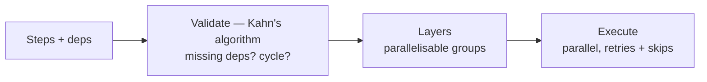

# flowforge

A small, correct DAG workflow orchestration engine. Describe a set of steps and
their dependencies; flowforge validates the graph, groups the steps into layers
that can run in parallel, and executes them with per-step retries and
failure-driven skip semantics — the core of what a CI pipeline or a task runner
does, in a few hundred readable lines.

[](.github/workflows/ci.yml)
[](pyproject.toml)
[](LICENSE)

---

## What it does



1. **Validate (`dag.py`).** Every dependency must name a real step, no step may
   depend on itself, and the graph must be acyclic. Validation and layering use
   **Kahn's algorithm**: repeatedly take the steps with no unresolved
   dependencies, which yields both a topological order and the dependency
   **layers**. If any steps remain with non-zero in-degree, they form a cycle and
   it is reported with the involved steps.
2. **Layer.** Steps in the same layer have no dependency on each other, so they
   are safe to run in parallel. `layers()` returns them grouped, e.g.
   `[[build], [lint, test], [package], [deploy]]`.
3. **Execute (`engine.py`).** Layer by layer. Within a layer, up to
   `FF_MAX_PARALLEL` steps run concurrently on a thread pool. A step runs only if
   **all** its dependencies succeeded; if any failed or was skipped, the step is
   **skipped** and records what blocked it, so a failure cascades cleanly instead
   of crashing the run. A failing step is retried up to its `max_retries`.

## Execution semantics

- **Success** — the step's action returned without raising (a step with no action
  is a no-op that always succeeds). Retries: a step is attempted
  `1 + max_retries` times; the first attempt that does not raise wins, and the
  `attempts` count is recorded.
- **Failed** — every attempt raised; the last error is captured. A step's failure
  never propagates as an exception out of the engine.
- **Skipped** — at least one dependency did not succeed. The step does not run and
  records the dependencies that blocked it. Skips cascade transitively
  (a step skipped because its dependency was skipped).
- **Run status** — `failed` if any step failed, otherwise `success`. Skips alone
  (with no failure) cannot happen, because a skip always traces back to a failure.

## Quick start

```bash
python -m venv .venv && source .venv/bin/activate
pip install -e ".[dev]"

python -m flowforge.cli demo        # run a flaky CI workflow and a failing one
uvicorn flowforge.main:app --reload # HTTP API
```

Build and run a workflow in code:

```python
from flowforge.engine import Engine
from flowforge.models import Step

steps = [
    Step("build"),
    Step("test", action=run_tests, depends_on=("build",), max_retries=2),
    Step("lint", depends_on=("build",)),                 # runs in parallel with test
    Step("deploy", action=deploy, depends_on=("test", "lint")),
]
report = Engine(max_parallel=4).run(steps)
print(report.status, report.layers)
```

## The HTTP API is structure-only, by design

`/validate` accepts a declarative spec (step names and dependencies) and returns
its layers or a validation error — it never executes anything. `/run/{name}` runs
a **built-in** workflow by name. The API deliberately does **not** accept
executable step bodies over HTTP: running arbitrary caller-supplied code in a web
service is a remote-code-execution hazard, so execution is limited to code that
ships with the server.

```bash
curl -s -X POST localhost:8000/validate -H 'content-type: application/json' \
  -d '[{"name":"a","depends_on":[]},{"name":"b","depends_on":["a"]}]'
curl -s -X POST localhost:8000/run/sample
```

## Configuration

| Variable          | Default | Meaning                                         |
| ----------------- | ------- | ----------------------------------------------- |
| `FF_MAX_PARALLEL` | `4`     | Max steps run concurrently within a layer       |

## Testing

```bash
ruff check flowforge tests
pytest --cov=flowforge --cov-report=term-missing --cov-fail-under=80
```

Covers the DAG (layering, topological order, missing-dep/self-dep/duplicate/cycle
errors), the engine (success, retry success, retry exhaustion, failure cascade,
parallel execution, no-op steps), the HTTP API (validate, cycle rejection, run,
404), and the CLI.

## Documentation

- `docs/architecture.md` — the DAG algorithms, execution model, and data flow.
- `docs/adr/` — the main design decisions and their trade-offs.
- `docs/estudio/` — a study guide in Spanish.

## License

[MIT](LICENSE) © Angelo David Padilla Romero
